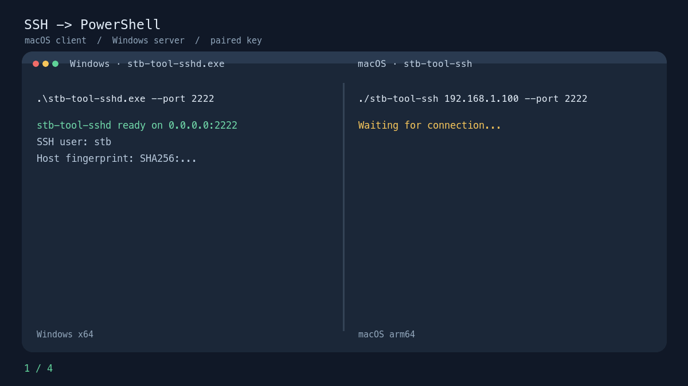

# SSH 工具：stb-tool-ssh / stb-tool-sshd

一套独立的 SSH → PowerShell 便携工具。它不调用 STB、tmux 或 RDC，也不读取这些项目的配置。本目录是独立 Go 模块；发布产物放在工具集合根目录的 `dist/ssh/`。



演示为操作流程示意，并非 Windows 实机录屏：Windows 启动监听，Mac 首次连接时核对主机指纹，随后进入交互式 PowerShell。

## 背景与适用场景

有些 Windows 目标机没有现成可用的 SSH 服务或新版 PowerShell，临时排障时也不适合先改动系统配置。这个工具把服务端、PowerShell 7 和配对认证封装成便携程序：在 Windows 前台启动监听，再从 Mac 用一条命令进入交互式 PowerShell。

它适合授权范围内的临时远程支持、排障和手工运维，也可以作为其他终端工作流的连接入口；它本身不依赖 STB，也不提供 STB 的共享会话、授权撤销或审计能力。完成操作后可直接结束服务端进程。

| 程序 | 平台 | 功能 |
| --- | --- | --- |
| `stb-tool-ssh` | macOS arm64 | 内置专属客户端私钥，连接指定 Windows IP 和端口，打开交互式 PowerShell |
| `stb-tool-sshd.exe` | Windows x64 | 内置对应公钥和 PowerShell 7 ZIP，按参数监听 SSH 端口 |

## 使用构建好的程序

在 Windows 上打开 PowerShell，运行：

```powershell
.\stb-tool-sshd.exe --port 2222
```

程序会显示监听地址、逻辑用户名和服务器指纹。首次运行会将内置 PowerShell 7 解压到当前 Windows 用户的配置目录，并在那里生成该机器专属的 SSH host key。程序以前台方式运行；按 `Ctrl+C` 结束。Windows 防火墙可能要求允许这个端口的入站连接。

在 Mac 上运行：

```bash
./stb-tool-ssh 192.168.1.100 --port 2222
```

登录名默认是 `stb`，两端都可用 `--user NAME` 修改。这个名称仅用于 SSH 认证；服务端启动的 PowerShell 使用**运行 `stb-tool-sshd.exe` 的 Windows 账户和权限**，不要求 Windows 有一个名为 `stb` 的用户。服务端还可用 `--listen IP` 指定绑定网卡。

首次连接时，Mac 会显示 Windows 端 SSH host key 指纹。核对 Windows 窗口显示的指纹后输入 `yes`。Mac 会将指纹保存在自己的配置目录；后续若同一 IP 和端口的指纹变化，连接会被拒绝。

当前 SSH 服务仅接受内置公钥认证，只支持交互式 `shell` 和窗口大小调整。它不提供远程 `exec`、端口转发、SFTP 或密码登录。PowerShell 运行在 Windows ConPTY 内，支持交互输入与 `Ctrl+C`。

## 从源码构建一对私有程序

需要 Go 1.26 和官方 PowerShell 7.6.6 Windows x64 ZIP。下载并放在：

```text
vendor-pwsh/PowerShell-7.6.6-win-x64.zip
```

官方文件下载地址：

```text
https://github.com/PowerShell/PowerShell/releases/download/v7.6.6/PowerShell-7.6.6-win-x64.zip
```

在 `ssh/` 目录运行：

```bash
go run ./cmd/package --pwsh-zip vendor-pwsh/PowerShell-7.6.6-win-x64.zip
```

构建程序会对照[微软发布页](https://github.com/PowerShell/PowerShell/releases/tag/v7.6.6)的 SHA256 验证 ZIP，生成一对 Ed25519 密钥，并交叉编译：

```text
../dist/ssh/stb-tool-ssh
../dist/ssh/stb-tool-sshd.exe
../dist/ssh/BUILD-INFO.txt
```

`private/client_ed25519` 保存构建所用私钥，后续构建会复用它。`private/`、`../dist/`、`vendor-pwsh/` 均被 Git 忽略；嵌入构建所需的临时源码和 ZIP 副本会在构建结束时移除。两个可执行文件属于**同一配对**，不要把某次生成的客户端和另一次生成的服务端混用。

## 权限与分发

Mac 程序内含可以登录对应 Windows 服务端的私钥，因此只能交给被授权的人。复制该 Mac 程序就等于复制访问凭据；泄露后要删除 `private/client_ed25519` 并重新构建、替换两端。Windows 上的每台机器各自生成 host key；复制服务端 EXE 不会复制 host key。

Windows EXE 未做代码签名，目标机器可能出现 SmartScreen 提示。PowerShell ZIP 是微软官方的便携发布包；它在目标机解压运行，不注册 Windows 服务，也不修改系统默认 Shell。第一版的 Windows 运行和 ConPTY 交互仍需在真实 Windows x64 机器上验收；macOS 端和 Windows 端已完成交叉编译检查。

## 项目结构

```text
go.mod                 SSH 专用 Go 模块
README.md              SSH 使用与构建说明
AGENTS.md              SSH 维护说明
cmd/stb-tool-ssh/      macOS 客户端、指纹固定
cmd/stb-tool-sshd/     Windows SSH 服务、ConPTY、PowerShell 解包
cmd/package/           私有密钥生成、ZIP 校验、双平台构建
internal/builddata/    构建时注入的密钥与包元数据
private/               本地配对私钥（Git 忽略）
../dist/ssh/           构建产物（Git 忽略）
```
